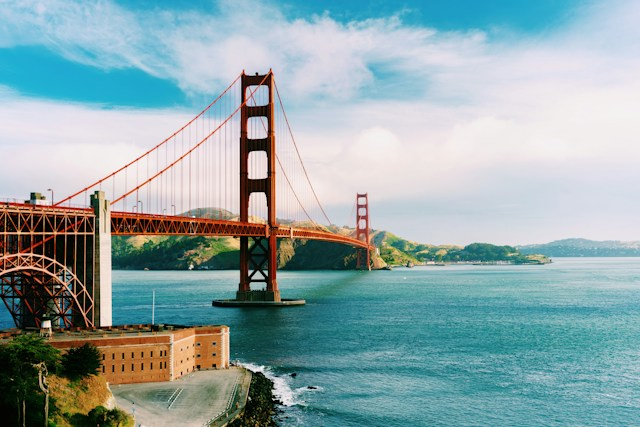

<small>Photo by <a href="https://unsplash.com/@sonuba?utm_source=unsplash&utm_medium=referral&utm_content=creditCopyText">Ragnar Vorel</a> on <a href="https://unsplash.com/photos/golden-state-bridge-san-francisco-o8Utw2ETExA?utm_source=unsplash&utm_medium=referral&utm_content=creditCopyText">Unsplash</a></small>

| Quick Info          |                     |
|---------------------|---------------------|
| **Co-located with** | [NAACL 2027](https://2027.naacl.org) |
| **Location**        | San Francisco, California, United States |
| **Dates**           | June 1-5, 2027 **(TBD)** |
| **Organizers**      | Ekaterina Kochmar, Bashar Alhafni, Stefano Bannò, Marie Bexte, Jill Burstein, Andrea Horbach, Ronja Laarmann-Quante, Anaïs Tack, Victoria Yaneva, Zheng Yuan |
| **Contact**         | [bea.nlp.workshop@gmail.com](mailto:bea.nlp.workshop@gmail.com) |
| **GitHub**          | To share your code and data with the BEA community, feel free to use the [#bea-workshop](https://github.com/topics/bea-workshop) topic. |

# Important Dates

All deadlines are 11:59pm UTC-12 (anywhere on earth). Please note that some deadlines are preliminary and may change slightly. Deadlines marked with an asterisk (*) are hard deadlines and will not be extended.
{: .notice--danger}

| Event                      | Date             |
|----------------------------|------------------|
| Paper submission deadline  | February 5, 2027 |
| Notification of acceptance | April 2, 2027    |
| Camera-ready paper due *   | April 16, 2027   |
| Pre-recorded video due *   | May 14, 2027     |
| Conference dates           | June 1-5, 2027   |

<!-- Proceedings due (hard deadline): May 7, 2027 -->
